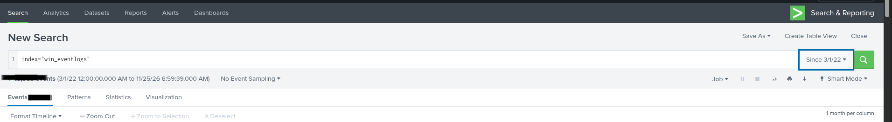
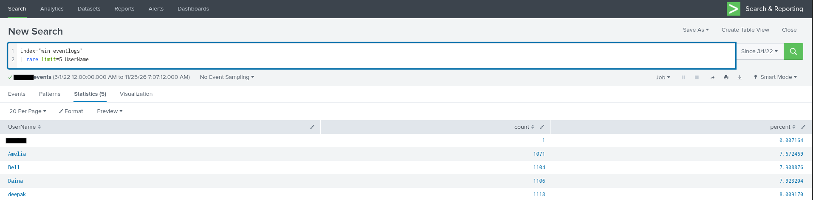
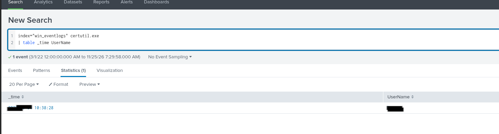
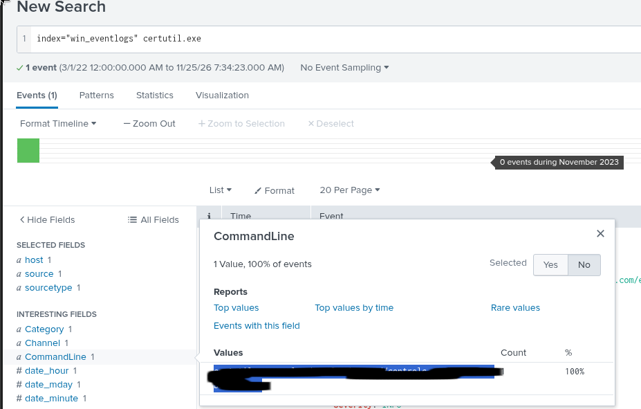

# Benign (TryHackMe)
**Platform:** TryHackMe | **Category:** SIEM / Log analysis | **Tools:** Splunk | **Date:** 2026-11-25

## Summary
An IDS alert flagged suspicious process execution on a host in the HR
department. Using Splunk and Windows process creation logs, I looked
for impersonated accounts, scheduled task abuse, and a built-in Windows
binary being used to download a payload.

## Data Source
- Index: `win_eventlogs`
- Event ID 4688 (process creation), the only event type in the data
- Time range set to All Time so no events were missed

## Investigation Approach

### 1. Scoping the data
I started with a search over the whole index and narrowed it by date
range to understand the volume of activity before looking for anything
unusual.



### 2. Finding anomalous accounts
I used `rare` on the username field to surface accounts with very few
events. This revealed an account whose name was a lookalike of a
legitimate user (a digit replacing a letter), which is a sign of an
impersonation attempt.

```
index="win_eventlogs" | rare limit=5 UserName
```



### 3. Hunting persistence
I searched for `schtasks` and inspected the CommandLine field. A
scheduled task was being created to run an executable from a user's
Temp directory, which is a common persistence technique.

```
index="win_eventlogs" schtasks
```

### 4. Hunting the payload download
I checked the LOLBAS project for built-in binaries that can download
files, and searched for `certutil.exe`. I then tabled the user and time
of each execution to see who ran it and when.

```
index="win_eventlogs" certutil.exe | table _time, UserName, CommandLine
```



The command line showed certutil fetching a file from an external
file-sharing site and saving an executable to disk, which matches
post-exploitation tool transfer.



## Indicators
- Lookalike username that matches no real employee
- Scheduled task pointing at an executable in a Temp directory
- certutil used with URL options to download from an external host
- Executable dropped on disk and then run

## How to Detect It
- Alert on `certutil.exe` command lines containing `-urlcache` or `-f`
  together with an `http(s)://` URL.
- Alert on `schtasks /create` where the program path is in Temp or
  AppData.
- Alert on accounts whose names differ by one character from an
  existing user.

## Mitigation
- Restrict or monitor certutil use for non-admin users.
- Block executables running from user Temp directories with
  application allowlisting.
- Apply egress filtering for file-sharing sites on corporate hosts.

## MITRE ATT&CK
- T1053.005 Scheduled Task
- T1105 Ingress Tool Transfer
- T1036 Masquerading


## Lessons Learned
Rare-value searches are a fast way to spot impostor accounts, and
command line fields reveal intent when the process name alone looks
legitimate.

